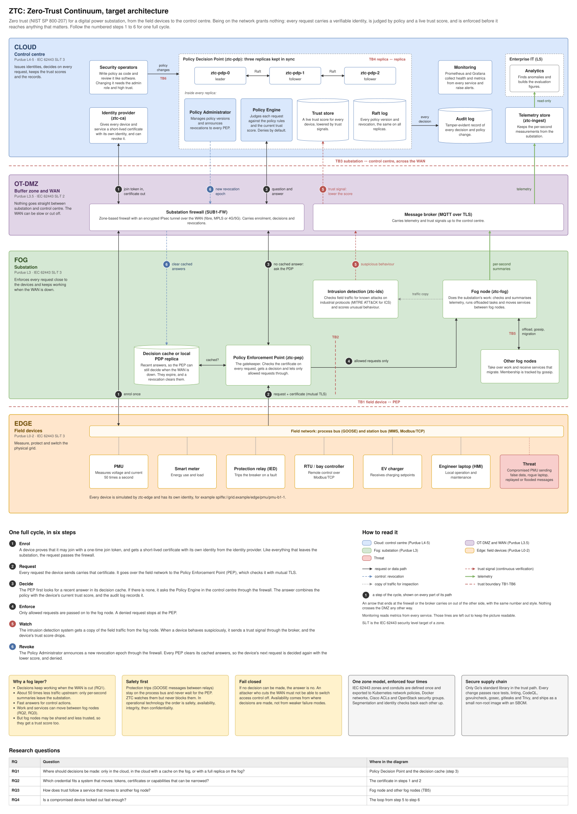

# 00 — System overview: at a glance and the target architecture

Diagram: [`00-system-overview.drawio`](00-system-overview.drawio) · 2 pages

## Page 1: at a glance

The same four layers and colours as the full target architecture, with one box per role and nothing else. Each layer has one job:

- **Cloud / control centre (L4-5)** decides: who is who (identity provider), what is allowed and how far to trust it (Policy Decision Point), and what is happening (telemetry and monitoring).
- **OT-DMZ (L3.5)** controls every crossing between the substation and the control centre. The firewall carries identities, decisions and revocations; the broker carries telemetry and trust signals.
- **Fog / substation (L3)** enforces: the Policy Enforcement Point checks every request locally and keeps recent answers so it keeps working when the WAN is down. The fog node does the local processing, and intrusion detection watches the traffic.
- **Edge (L0-2)** is the physical grid: devices that measure, protect and control, charge and maintain, each with its own identity. The threat sits on the same field network.

The numbers are the same six steps as on page 2, so the two pages can be read side by side.

## Page 2: target architecture

The complete ZTC system in a digital substation, laid out on the edge-fog-cloud continuum and on the Purdue model at the same time:

- **Cloud / control centre (L4-5)**: a Raft-replicated Policy Decision Point (`ztc-pdp` ×3) in which every replica holds the Policy Engine, the Policy Administrator, the trust store and the Raft log; the identity provider (`ztc-ca`), the hash-chained audit log, the telemetry store (`ztc-ingest`), monitoring and the operators. Analytics sits in a separate enterprise zone (L5).
- **OT-DMZ (L3.5)**: the zone-based firewall with an IPsec tunnel over the WAN, and an MQTT broker. Every flow between fog and cloud ends at one of them, and an arrow into either continues out of the other side with the same number and style.
- **Fog / substation (L3)**: the Policy Enforcement Point (`ztc-pep`) with its decision cache or local PDP replica, the fog node (`ztc-fog`: telemetry pipeline, offloading, migration), the ICS intrusion detection system (`ztc-ids`) and the other fog nodes.
- **Edge (L0-2)**: PMUs, smart meters, protection relays, RTUs, EV chargers and engineer laptops on the field network, simulated by `ztc-edge`, each with its own SPIFFE identity.

### One full cycle, in six steps

1. **Enrol.** A device proves that it may join with a one-time join token, and gets a short-lived certificate with its own identity from the identity provider. Like everything that leaves the substation, the request passes the firewall.
2. **Request.** Every request the device sends carries that certificate. It goes over the field network to the Policy Enforcement Point (PEP), which checks it with mutual TLS.
3. **Decide.** The PEP first looks for a recent answer in its decision cache. If there is none, it asks the Policy Engine in the control centre through the firewall. The answer combines the policy with the device's current trust score, and the audit log records it.
4. **Enforce.** Only allowed requests are passed on to the fog node. A denied request stops at the PEP.
5. **Watch.** The intrusion detection system gets a copy of the field traffic from the fog node. When a device behaves suspiciously, it sends a trust signal through the broker, and the device's trust score drops.
6. **Revoke.** The Policy Administrator announces a new revocation epoch through the firewall. Every PEP clears its cached answers, so the device's next request is decided again with the lower score, and denied.

The red dashed lines are the trust boundaries TB1-TB6 analysed in the [threat model](11-m5-threat-model.md). Monitoring reads metrics from every service; those lines are left out to keep the picture readable.

## Key design decisions

| Decision | Alternatives considered | Why this one |
|---|---|---|
| NIST SP 800-207 split: PDP decides, PEP enforces, as separate services | an authorization library inside each service; an API gateway with built-in rules | One place to change policy and audit decisions; the PEP can sit next to the workload on the fog while the PDP lives where it is safest. A compromised PEP cannot change policy or trust. |
| Identity-based access, never network location | VPN / perimeter firewall that trusts the substation LAN | The substation LAN is exactly where a rogue laptop or compromised IED appears. Every request carries a short-lived, verifiable identity. |
| Continuous trust score in the decision | static RBAC | Lets the system lock out a device that is authenticated but misbehaving, without rewriting policy (RQ4). |
| Decision cache or PDP replica on the fog | every decision in the cloud | Keeps deciding when the WAN is slow or partitioned; the cost is bounded staleness, managed with TTLs and revocation epochs (RQ1). |
| Raft-replicated PDP cluster | single PDP; etcd/Consul | No single point of failure in the control plane; written by hand to keep the trust path dependency-free and as IN5020 practice. |
| Fail closed everywhere ([ADR 0001](../adr/0001-fail-closed.md)) | fail open for availability | An attacker who can cut the WAN must not be able to switch access control off. Availability comes from placement, not from weaker failure modes. |
| Protection (GOOSE trips) stays outside the PEP path | gate every message | Safety comes first in OT: a relay must trip within milliseconds. ZTC observes protection traffic and never delays it. |
| IEC 62443 zones and conduits, defined once and exported | hand-written ACLs per layer | Network segmentation and identity-based authorization are complementary layers (defence in depth); one model prevents drift between them. |

## Standards mapping

- **NIST SP 800-207**: PE, PA, PEP, CDM, PKI, ID management, activity logs; all seven tenets (see [02](02-nist-zta-mapping.md)).
- **IEC 62443**: zones with SL-T 2–3, conduits through the DMZ, FR1–FR7 (see [10](10-m5-iec62443-zones.md)).
- **Purdue model**: L0–2 edge, L3 fog, L3.5 DMZ, L4–5 cloud.
- **IEC 61850**: GOOSE / MMS on the process and station buses.

## Interview talking points

- *What makes this zero trust and not just segmentation?* Every request is authenticated and authorized individually, with a decision that depends on a continuously updated trust score. Network location grants nothing; segmentation only shrinks the attack surface.
- *What happens when the substation loses its WAN link?* With hierarchical or fog placement the PEP keeps deciding from its cache or replica. With cloud-only placement it denies everything, because the system fails closed. Measuring that trade-off is RQ1.
- *How fast is a compromised device locked out?* Detection delay + signal transport + cache staleness. The revocation epoch and invalidate-on-deny keep the staleness part small (RQ4).
- *Why is the fog different from cloud zero trust?* Intermittent connectivity, constrained and multi-party nodes, and workloads that move. Each of the four research questions targets one of those differences.
