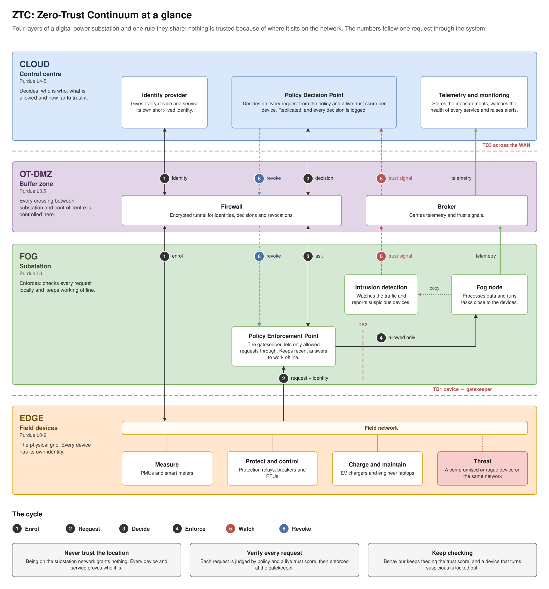

# 00 — System overview: the target architecture

Diagram: [`00-system-overview.drawio`](00-system-overview.drawio) · 1 page

## What it shows

The complete ZTC system in a digital substation, laid out on the edge–fog–cloud continuum and on the Purdue model at the same time:

- **Cloud / control centre (L4–5)**: a Raft-replicated Policy Decision Point (`ztc-pdp` ×3) holding the Policy Engine and Policy Administrator, the identity provider (`ztc-ca`), the hash-chained audit log, the telemetry store (`ztc-ingest`), Prometheus/Grafana and the operator. Analytics sits in a separate enterprise zone (L5).
- **OT-DMZ + WAN (L3.5)**: the zone-based firewall with IPsec to the control centre, a broker and a jump host. Every flow between fog and cloud passes through it.
- **Fog / substation (L3)**: the Policy Enforcement Point (`ztc-pep`) with a decision cache or PDP replica, the fog node (`ztc-fog`: telemetry pipeline, offloading, gossip, Chord placement, migration), the ICS intrusion detection system (`ztc-ids`) and peer fog nodes.
- **Edge (L0–2)**: PMUs, meters, breakers/IEDs, RTUs, EV chargers and HMIs, simulated by `ztc-edge`, each with its own SPIFFE identity.

The numbered path ① → ⑥ is one full cycle of zero trust: a device enrols and sends a request with a credential (①), the PEP asks for a decision (②), on a cache miss the cloud PDP decides (③), the allowed request reaches the fog node (④), the IDS turns abnormal behaviour into a trust signal (⑤), and the PDP pushes a revocation epoch that flushes every cache (⑥). The red dashed lines are the trust boundaries TB1–TB6 analysed in the [threat model](11-m5-threat-model.md).

## Key design decisions

| Decision | Alternatives considered | Why this one |
|---|---|---|
| NIST SP 800-207 split: PDP decides, PEP enforces, as separate services | an authorization library inside each service; an API gateway with built-in rules | One place to change policy and audit decisions; the PEP can sit next to the workload on the fog while the PDP lives where it is safest. A compromised PEP cannot change policy or trust. |
| Identity-based access, never network location | VPN / perimeter firewall that trusts the substation LAN | The substation LAN is exactly where a rogue laptop or compromised IED appears. Every request carries a short-lived, verifiable identity. |
| Continuous trust score in the decision | static RBAC | Lets the system lock out a device that is authenticated but misbehaving, without rewriting policy (RQ4). |
| Decision cache or PDP replica on the fog | every decision in the cloud | Keeps deciding when the WAN is slow or partitioned; the cost is bounded staleness, managed with TTLs and revocation epochs (RQ1). |
| Raft-replicated PDP cluster | single PDP; etcd/Consul | No single point of failure in the control plane; written by hand to keep the trust path dependency-free and as IN5020 practice. |
| Fail closed everywhere ([ADR 0001](../adr/0001-fail-closed.md)) | fail open for availability | An attacker who can cut the WAN must not be able to switch access control off. Availability comes from placement, not from weaker failure modes. |
| Protection (GOOSE trips) stays outside the PEP path | gate every message | Safety comes first in OT: a relay must trip within milliseconds. ZTC observes protection traffic and never delays it. |
| IEC 62443 zones and conduits, defined once and exported | hand-written ACLs per layer | Network segmentation and identity-based authorization are complementary layers (defence in depth); one model prevents drift between them. |

## Standards mapping

- **NIST SP 800-207**: PE, PA, PEP, CDM, PKI, ID management, activity logs; all seven tenets (see [02](02-nist-zta-mapping.md)).
- **IEC 62443**: zones with SL-T 2–3, conduits through the DMZ, FR1–FR7 (see [10](10-m5-iec62443-zones.md)).
- **Purdue model**: L0–2 edge, L3 fog, L3.5 DMZ, L4–5 cloud.
- **IEC 61850**: GOOSE / MMS on the process and station buses.

## Interview talking points

- *What makes this zero trust and not just segmentation?* Every request is authenticated and authorized individually, with a decision that depends on a continuously updated trust score. Network location grants nothing; segmentation only shrinks the attack surface.
- *What happens when the substation loses its WAN link?* With hierarchical or fog placement the PEP keeps deciding from its cache or replica. With cloud-only placement it denies everything, because the system fails closed. Measuring that trade-off is RQ1.
- *How fast is a compromised device locked out?* Detection delay + signal transport + cache staleness. The revocation epoch and invalidate-on-deny keep the staleness part small (RQ4).
- *Why is the fog different from cloud zero trust?* Intermittent connectivity, constrained and multi-party nodes, and workloads that move. Each of the four research questions targets one of those differences.
