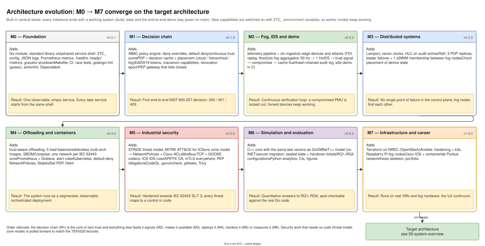

# 01 — Architecture evolution: from M0 to the target

Diagram: [`01-architecture-evolution.drawio`](01-architecture-evolution.drawio) · 2 pages

## Page 1 — Milestone evolution

Eight milestones, each ending in a tagged, working system. Every card lists what the milestone adds and what the system can do afterwards. Read left to right, top to bottom: the architecture grows by one layer at a time until it matches [00 System overview](00-system-overview.md).

| Milestone | Adds | Architectural effect |
|---|---|---|
| M0 Foundation | Go module, shared service shell, CI | every service is observable and operable in the same way |
| M1 Decision chain | policy engine, trust score, PDP, tokens/capabilities, PEP | the first NIST 800-207 decision path exists |
| M2 Fog, IDS, demo | telemetry, edge devices, fog node, IDS, audit, e2e demo | the continuous verification loop closes |
| M3 Distributed systems | clocks, Raft, SWIM, Chord | the control plane has no single point of failure |
| M4 Offloading, containers | offloading, images, Compose, monitoring, Kubernetes | the system runs as a segmented, orchestrated deployment |
| M5 Industrial security | threat model, zone model, ICS protocols, mTLS, scanning | hardened towards IEC 62443 SL-T 3 |
| M6 Simulation, evaluation | C++ core, OMNeT++, migration, analytics | RQ1–RQ4 are answered with numbers |
| M7 Infrastructure | Terraform, Ansible, Cisco network | runs on real VMs and fog hardware |

## Page 2 — Component growth

A matrix of every service and repository area against the milestones: ● where it is introduced, ◐ where it is extended. It shows that most services start small (for example `ztc-ca` issues only tokens in M1 and gains X.509-SVIDs in M5) and grow without being rewritten.

## Design decisions

| Decision | Alternatives considered | Why this one |
|---|---|---|
| Vertical slices: a thin end-to-end system first, then widen | build all libraries first, then the services (how the reference version was built) | Integration problems surface in week one instead of month four, and there is always something to demo. |
| Every merge keeps build, tests and demo green; new behaviour behind `ZTC_` flags | long-lived feature branches; big-bang switch-overs | `main` is always presentable; mTLS, Raft and gossip can be switched on without breaking the plain mode. |
| Decision chain (M1) before fog features (M2) | start with the fog node and telemetry | The PDP/PEP chain is the zero-trust core; everything later feeds it signals, replicates it, deploys it or measures it. |
| Paper-only security work (threat model, zone model) pulled forward | do all security in one late milestone | Security analysis should shape the design, not audit it afterwards; it also matches the TEK5520 lecture plan. |
| ADRs written in the same branch as the code | a documentation phase at the end | The rationale is recorded when it is fresh, and reviewers see code and reasoning together. |

## Interview talking points

- *How did you plan a project this size?* Thematic milestones with a definition of done each, small branches with one purpose, and a rule that `main` always runs the demo.
- *How do you add a big feature like mTLS without breaking everything?* Behind an environment flag (`ZTC_TLS=true`), with its own CI variant of the demo, until it becomes the default.
