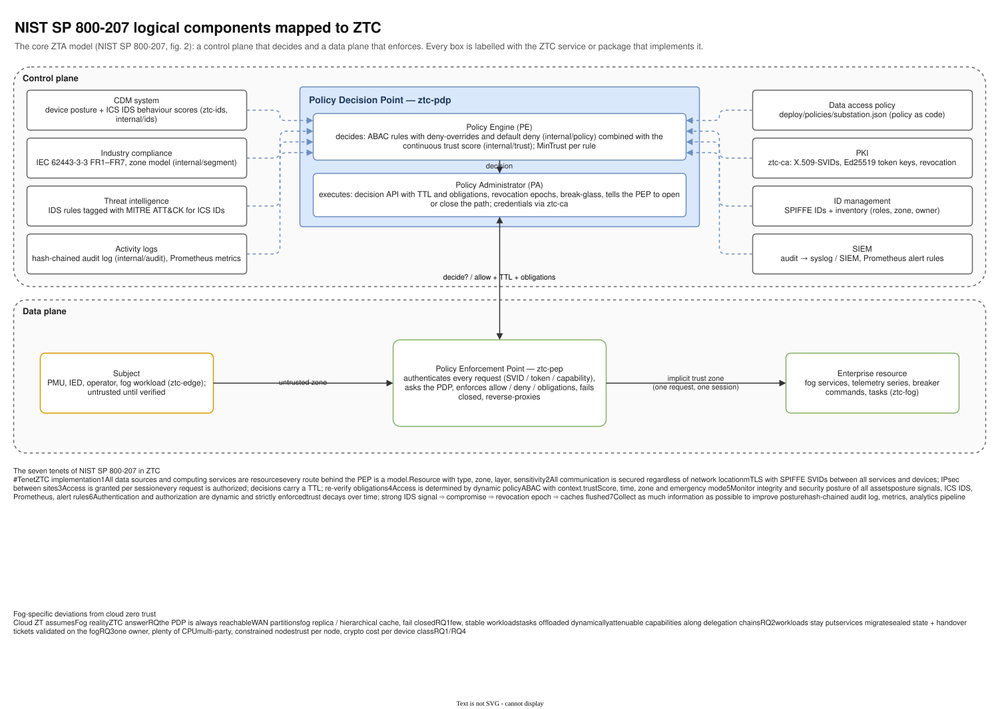

# 02 — NIST SP 800-207 mapping

Diagram: [`02-nist-zta-mapping.drawio`](02-nist-zta-mapping.drawio) · 1 page

## What it shows

The logical zero-trust architecture from NIST SP 800-207 (figure 2 in the standard), with every box labelled with the ZTC service or Go package that implements it.

- **Control plane**: the Policy Decision Point (`ztc-pdp`) contains the **Policy Engine**, which decides (ABAC rules + trust score), and the **Policy Administrator**, which carries the decision out (decision API with TTL and obligations, revocation epochs, break-glass, credentials via `ztc-ca`).
- **Data plane**: an untrusted **subject** (device, operator, workload) reaches an **enterprise resource** only through the **Policy Enforcement Point** (`ztc-pep`), and only for one request at a time.
- **Inputs to the Policy Engine**: CDM (posture + IDS), industry compliance (IEC 62443), threat intelligence (ATT&CK for ICS), activity logs (audit, metrics) on the left; data access policy (policy as code), PKI, ID management (SPIFFE + inventory) and SIEM on the right.

Below the figure, two tables: how ZTC implements each of the seven tenets, and where the fog forces ZTC to deviate from cloud-style zero trust.

## Component mapping

| NIST 800-207 component | ZTC | Package |
|---|---|---|
| Policy Engine | ABAC engine + trust algorithm | `internal/policy`, `internal/trust` |
| Policy Administrator | PDP service, revocation list, credential issuance | `internal/pdp`, `cmd/ztc-ca` |
| Policy Enforcement Point | identity-aware reverse proxy | `internal/pep`, `cmd/ztc-pep` |
| Continuous diagnostics and mitigation | device posture + IDS signals | `internal/ids`, `cmd/ztc-ids` |
| Activity logs / threat intelligence | hash-chained audit log, Prometheus, ATT&CK-tagged rules | `internal/audit`, `internal/observability` |
| ID management / PKI | SPIFFE IDs, short-lived X.509, signed tokens, capabilities | `internal/identity`, `internal/token` |
| Data access policy | `deploy/policies/substation.json` | `internal/policy/default.go` |

## Design decisions

| Decision | Alternatives considered | Why this one |
|---|---|---|
| PE and PA in one process (`ztc-pdp`) | separate services as drawn in some vendor architectures | They share state (policy version, trust, epochs) on every decision; splitting them would add a network hop and a consistency problem without a security gain at this scale. |
| Trust score computed inside the PDP | external risk service | Keeps the decision atomic: the score used is the score at decision time, stamped with PDP-owned time. |
| Enterprise-resource-side PEP (reverse proxy on the fog) | device agent PEP; gateway in the cloud | Field devices cannot run agents; a cloud gateway would put the WAN in every request path. |

## Interview talking points

- *Explain NIST 800-207 in one minute.* A policy engine decides every access from identity, context and trust; an administrator executes that decision; an enforcement point sits in front of every resource and lets exactly one approved session through. Nothing is trusted because of where it is on the network.
- *Where is your trust algorithm on this picture?* Inside the Policy Engine. Its inputs are the CDM, logs and identity boxes; its output is `context.trustScore`, which policy rules use like any other attribute.
