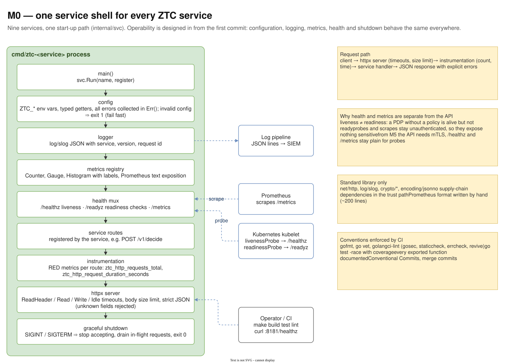
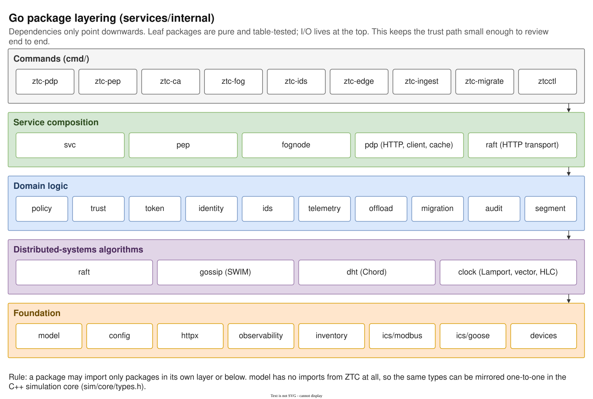

# 03 — M0 Service foundation

Diagram: [`03-m0-service-foundation.drawio`](03-m0-service-foundation.drawio) · 2 pages

## Page 1 — One service shell

Every `cmd/ztc-*` binary starts through the same path in `internal/svc`: configuration from `ZTC_` environment variables (all errors collected, invalid config exits immediately), a JSON logger, a Prometheus registry, a health mux (`/healthz`, `/readyz`, `/metrics`), the service's own routes wrapped in RED-metric instrumentation, an HTTP server with explicit timeouts and body limits, and graceful shutdown on SIGINT/SIGTERM. Prometheus, the Kubernetes kubelet, the log pipeline and CI are the external consumers.

## Page 2 — Package layering

The Go packages in five layers: commands, service composition, domain logic, distributed-systems algorithms and foundation. Imports only point downwards. `model` imports nothing from ZTC, so its types can be mirrored one-to-one in the C++ simulation core.

## Design decisions

| Decision | Alternatives considered | Why this one |
|---|---|---|
| One shared service shell | each service wires its own server, logging and metrics | Nine services behave identically under probes, scrapes and shutdown; a fix lands everywhere at once. |
| Go standard library only (ADR in M1) | gin/echo, prometheus/client_golang, golang-jwt | No third-party code in the trust path, so the whole path can be read and reviewed; fewer supply-chain risks. Production equivalents are noted where they exist. |
| Separate liveness and readiness | one `/health` endpoint | A PDP without a policy is alive (do not restart it) but not ready (do not send it traffic). Kubernetes acts differently on the two. |
| Health and metrics stay unauthenticated, API gets mTLS in M5 | protect everything | Probes and scrapers need simple access and the endpoints expose nothing sensitive; the API is where the risk is. |
| Fail fast on invalid configuration | defaults that hide mistakes | A typo in `ZTC_PLACEMENT` should stop the service at start, not silently run cloud mode. |
| Explicit server timeouts and body limits | `http.ListenAndServe` defaults | Default Go servers have no timeouts: slowloris and huge bodies become DoS vectors (gosec flags this). |
| Strict layering, `model` without dependencies | packages that import each other freely | Keeps leaf packages pure and table-testable, avoids cycles and makes the Go ↔ C++ mirror possible. |

## Interview talking points

- *What do you build before any feature?* Observability and operability: metrics, health probes, structured logs, graceful shutdown and CI. Every later service gets them for free.
- *Why no frameworks?* Security-critical code should be small enough to read end to end. The standard library covers HTTP, JSON, crypto and logging well.
