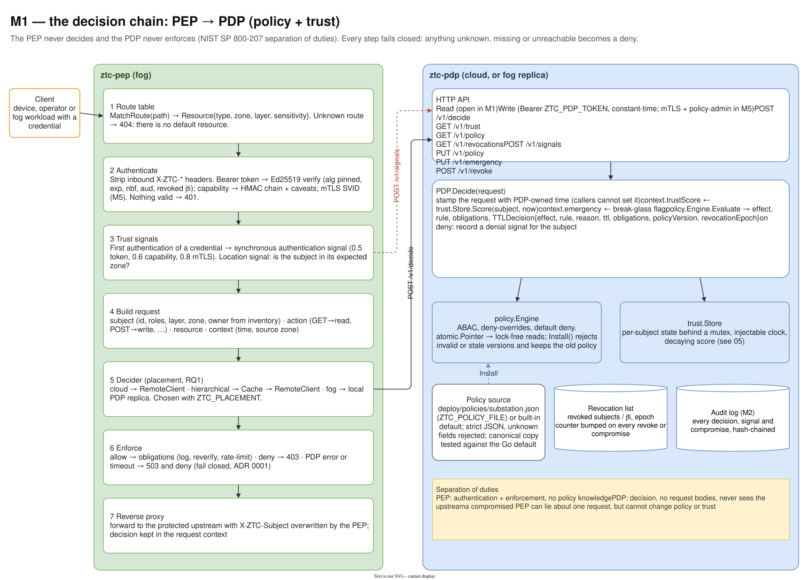
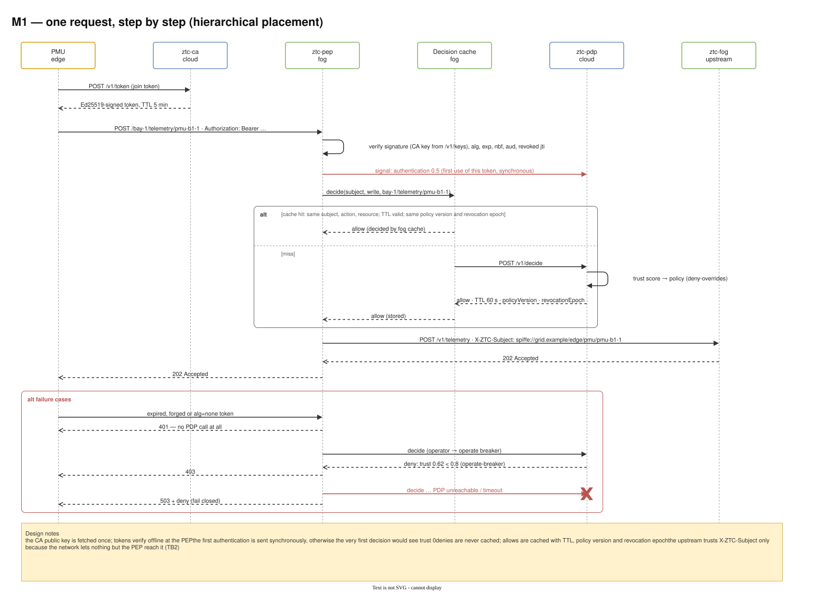
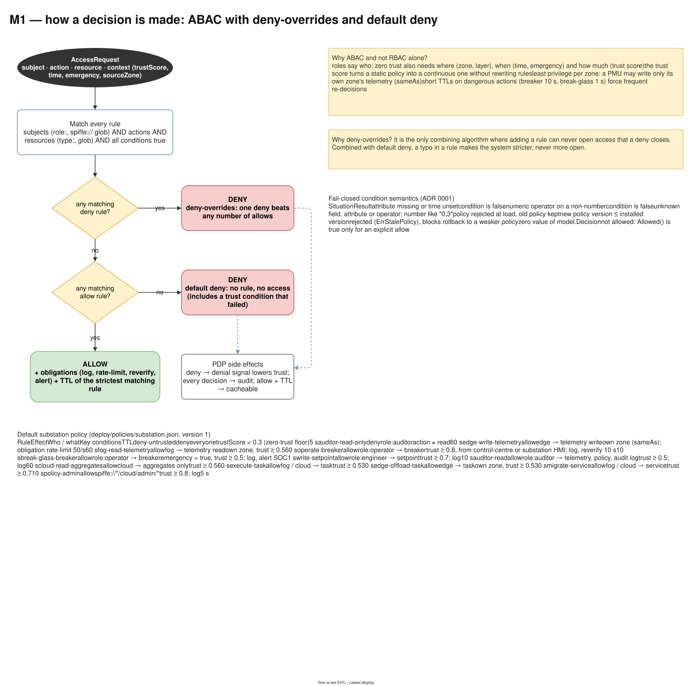

# 04 — M1 Decision chain: PEP → PDP

Diagram: [`04-m1-decision-chain.drawio`](04-m1-decision-chain.drawio) · 3 pages

## Page 1 — PEP and PDP components

Inside the PEP, a request passes seven steps: route lookup, authentication, trust signals, building the access request, the placement-dependent decider, enforcement and the reverse proxy. Inside the PDP, the HTTP API (open reads, token-protected writes per [ADR 0002](../adr/0002-pdp-write-token.md)) calls `PDP.Decide`, which combines the trust store and the policy engine and returns a decision with TTL, obligations, policy version and revocation epoch.

## Page 2 — Request sequence

One telemetry write from a PMU in hierarchical placement: token from `ztc-ca`, offline verification at the PEP, a synchronous first authentication signal, cache hit or miss, forwarding with `X-ZTC-Subject`. The red frame shows the three failure paths: invalid token → 401 without asking the PDP, policy or trust deny → 403, PDP unreachable → 503 and deny.

## Page 3 — Policy evaluation

The decision algorithm as a flowchart (deny-overrides, then default deny), the fail-closed condition semantics, and the full default substation policy: thirteen rules from the zero-trust floor (`deny-untrusted`, trust < 0.3) to `policy-admin`.

## Design decisions

| Decision | Alternatives considered | Why this one |
|---|---|---|
| ABAC with the trust score as an attribute | RBAC; RBAC + separate risk check | Roles say *who*; zero trust also needs *where* (zone, layer), *when* (time, emergency) and *how much* (trust). Putting trust in `context.trustScore` keeps it in ordinary policy conditions. |
| Deny-overrides + default deny | permit-overrides; first-applicable | Adding a rule can never open access a deny closes; a broken or missing rule makes the system stricter. |
| Fail closed: PDP error → 503 + deny | fail open; serve the last decision | Cutting the WAN must not disable access control (ADR 0001). |
| PDP owns time and trust | caller supplies time / context | A caller could otherwise replay old timestamps or claim high trust. |
| Strict policy loading: unknown fields rejected, stale versions refused | lenient JSON | A typo cannot silently drop a condition, and nobody can roll back to an older, weaker policy. |
| Lock-free policy reads (`atomic.Pointer`) | mutex around the policy | Decisions are on the hot path; installs are rare. |
| First authentication signal is synchronous | fire-and-forget signal | Otherwise the very first decision would see trust 0 and deny a legitimate device. |
| Denies are never cached | cache all decisions | A cached deny would hide a legitimate recovery; a cached allow is bounded by TTL and epochs instead. |
| PEP strips inbound `X-ZTC-*` headers and sets the subject itself | trust headers from clients | Prevents header spoofing (threat T6); the upstream relies on network isolation to know only the PEP can reach it (TB2). |
| Short TTLs on dangerous actions (breaker 10 s, break-glass 1 s) | one global TTL | Forces frequent re-decisions exactly where the impact is highest. |

## Interview talking points

- *Walk me through one request.* Authenticate the credential offline, send the first authentication as a trust signal, ask the cache or PDP, PDP looks up trust and evaluates rules, PEP enforces and proxies with a subject header it set itself.
- *What if the policy file has a typo?* Loading fails, the old policy stays installed, the error names the rule and the field.
- *How do you do break-glass in zero trust?* As a policy rule, not a bypass: `context.emergency = true` still needs trust ≥ 0.5, is cached for one second and raises an alert.
