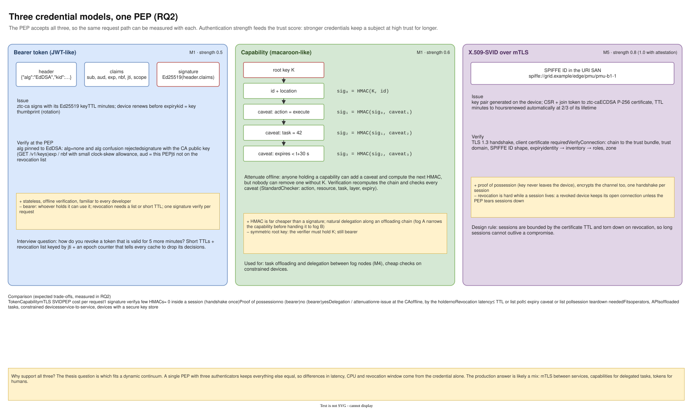
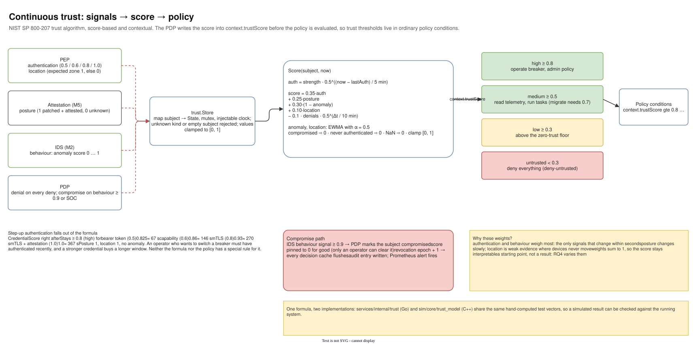
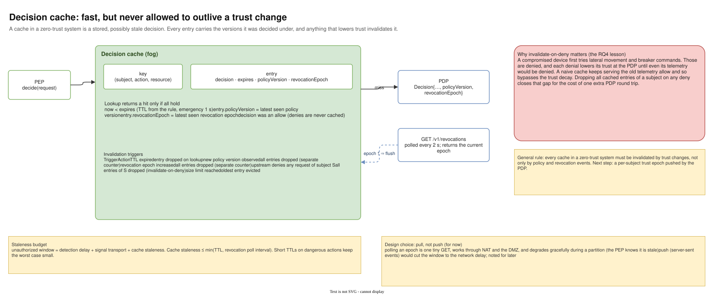

# 05 — M1 Credentials, trust and caching

Diagram: [`05-m1-credentials-and-trust.drawio`](05-m1-credentials-and-trust.drawio) · 3 pages

## Page 1 — Three credential models (RQ2)

The PEP accepts three credential types so they can be compared on the same request path:

- **Bearer token (JWT-like)**: Ed25519-signed claims (`sub`, `aud`, `exp`, `nbf`, `jti`, `scope`), verified offline with the CA's public key; algorithm pinned so `alg=none` and algorithm confusion fail. Authentication strength 0.5.
- **Capability (macaroon-like)**: an HMAC chain where every caveat (action, task, expiry, target) narrows the rights. Anyone holding it can attenuate it offline; nobody can widen it without the root key. Strength 0.6.
- **X.509-SVID over mTLS** (M5): proof of key possession, encrypted channel, one handshake per session. Strength 0.8, or 1.0 with attestation.

## Page 2 — Trust algorithm (RQ4)

Signals from the PEP (authentication, location), attestation (posture), the IDS (behaviour) and the PDP itself (denials, compromise) feed a per-subject store. The score decays authentication over a 5-minute half-life, weighs behaviour heavily, subtracts recent denials and maps to four levels used by policy. A behaviour signal ≥ 0.9 pins the subject to 0 and bumps the revocation epoch. The same formula and test vectors exist in Go and in the C++ simulation core.

## Page 3 — Decision cache and revocation

A cache entry is only a hit while its TTL is valid and its policy version and revocation epoch match the latest seen. Any deny for a subject drops all of that subject's cached allows (invalidate-on-deny). The PEP polls `GET /v1/revocations` for the epoch.

## Design decisions

| Decision | Alternatives considered | Why this one |
|---|---|---|
| Support three credential models in one PEP | pick one up front | The thesis question (RQ2) is which fits a dynamic continuum; one PEP keeps everything else equal. Production answer is likely a mix: mTLS between services, capabilities for delegated tasks, tokens for humans. |
| Ed25519 for tokens | RSA, ECDSA P-256, HMAC-signed JWT | Small keys and signatures, fast verification, no nonce pitfalls; asymmetric so PEPs cannot mint tokens. |
| Capabilities for delegation | re-issue a token at the CA for every hop | Offline attenuation along an offloading chain without a round trip to the cloud; HMAC is much cheaper to verify than a signature. |
| Short TTLs + revocation list + epoch | long-lived tokens with CRL/OCSP | Fog nodes may not reach a CRL during a partition; short lifetimes bound the damage, the epoch handles the urgent cases. |
| Authentication decays over time | authentication is binary | Gives step-up authentication for free: operating a breaker (trust ≥ 0.8) needs a recent, strong authentication, without a special rule. |
| Weights 0.35 / 0.25 / 0.30 / 0.10 | equal weights; learned weights | Authentication and behaviour change within seconds, posture slowly, location barely in a substation. A documented starting point that RQ4 varies. |
| Invalidate-on-deny | invalidate only on policy or revocation events | A naive cache keeps serving an old allow while the subject's trust falls, bypassing the trust decay. Every cache in a zero-trust system must react to trust changes. |
| Pull the epoch (poll) rather than push | server-sent events / websockets | Works through NAT and the DMZ, and the PEP knows when it is stale during a partition. Push is noted as an improvement. |

## Interview talking points

- *How do you revoke a token that is valid for five more minutes?* Short TTLs, a revocation list keyed by `jti`, and an epoch counter that tells every cache to drop its decisions.
- *JWT, mTLS or macaroons?* Depends on the hop: mTLS gives proof of possession between services, macaroons give cheap offline delegation, bearer tokens are simplest for people and APIs.
- *Why can a cache be a security bug?* It stores a decision made under old conditions. If trust drops and the cache does not notice, the system keeps allowing a subject the PDP would now deny.
