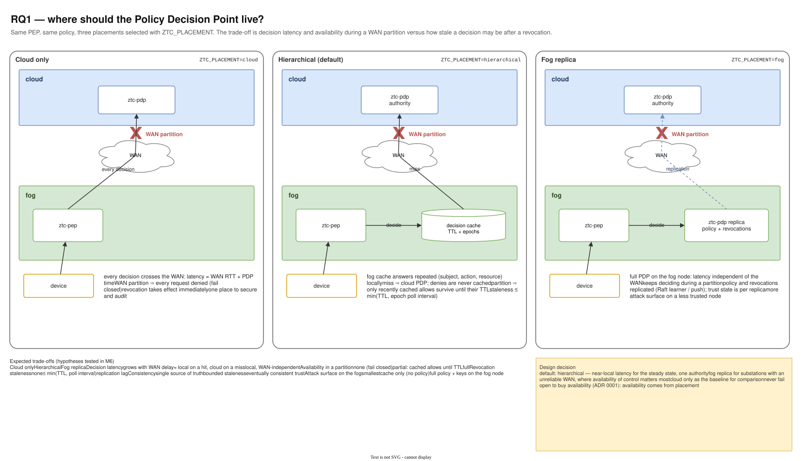

# 06 — RQ1: where should the Policy Decision Point live?

Diagram: [`06-rq1-pdp-placement.drawio`](06-rq1-pdp-placement.drawio) · 1 page

## What it shows

The same PEP and policy in three placements, selected with `ZTC_PLACEMENT`:

- **Cloud only**: every decision crosses the WAN. Simple and always up to date, but a WAN partition denies everything.
- **Hierarchical** (default): a decision cache on the fog answers repeated requests locally; misses go to the cloud authority. During a partition only recently cached allows survive until their TTL.
- **Fog replica**: a full PDP on the fog node keeps deciding during a partition, at the cost of replicated policy, per-replica trust state and more attack surface on a less trusted node.

The table summarises the expected trade-offs, which the OMNeT++ evaluation measures (see [14](14-m6-simulation-evaluation.md)).

## Design decisions

| Decision | Alternatives considered | Why this one |
|---|---|---|
| Placement is a runtime choice, not a fork of the code | separate builds per placement | One code path (`pdp.Chain`, `RemoteClient`, `Cache`) composes into all three, so the comparison is fair. |
| Hierarchical as the default | cloud only; fog replica everywhere | Near-local latency in steady state with one authority for policy and revocation. |
| Fog replica where WAN reliability is poor | always hierarchical | In a substation, losing control during a WAN outage can be worse than slightly stale decisions; the choice is per site. |
| Never fail open to gain availability | serve stale allows indefinitely | Availability must come from placement, not from turning off access control (ADR 0001). |
| Bound staleness explicitly (TTL, epoch poll, invalidate-on-deny) | best-effort caching | The worst-case window must be a number that can be stated and measured. |

## Interview talking points

- *CAP theorem in practice?* During a partition the cloud placement chooses consistency (deny), the fog replica chooses availability (decide on possibly stale policy), and hierarchical sits between with a bounded staleness window.
- *What would you pick for a real utility?* Hierarchical by default, fog replica at sites with unreliable links, and short TTLs on dangerous actions everywhere.
