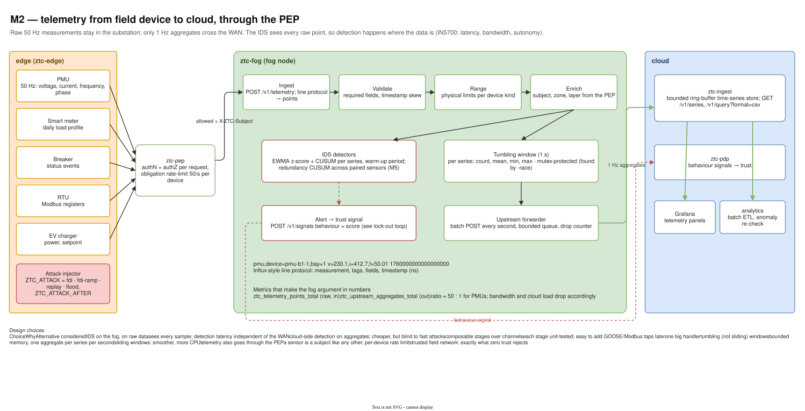
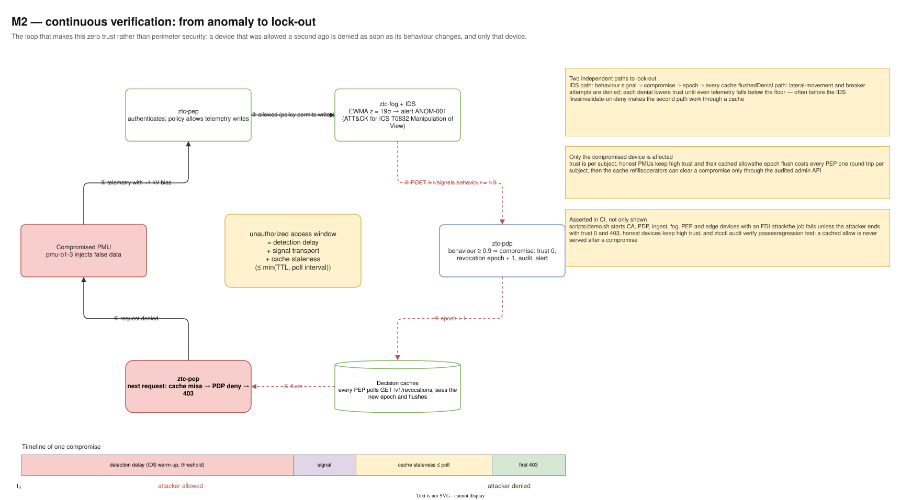
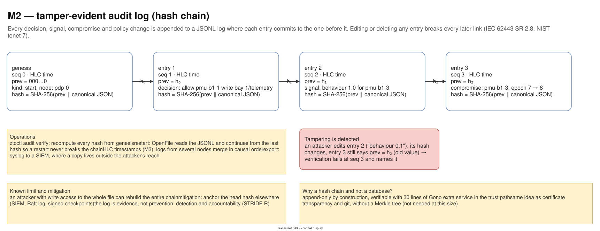

# 07 — M2 Fog, telemetry and IDS

Diagram: [`07-m2-fog-telemetry-ids.drawio`](07-m2-fog-telemetry-ids.drawio) · 3 pages

## Page 1 — Telemetry pipeline

Simulated field devices (and an attack injector) send telemetry through the PEP to the fog node. The fog node parses Influx-style line protocol, validates, range-checks and enriches each point, then fans out to the IDS detectors and to one-second tumbling windows. Only the aggregates go upstream to `ztc-ingest`; IDS alerts become behaviour signals to the PDP.

## Page 2 — Lock-out loop (RQ4)

The continuous-verification loop: a compromised PMU injects false data ①, the PEP still allows it because the policy permits telemetry writes ②, the IDS flags it (EWMA z-score, ATT&CK for ICS T0832) and sends a behaviour signal ③, the PDP marks the device compromised and bumps the revocation epoch ④, every PEP flushes its cache ⑤, and the next request is denied ⑥. The timeline at the bottom breaks the unauthorized window into detection delay, signal transport and cache staleness.

## Page 3 — Audit log

An append-only JSONL log where each entry contains the hash of the previous one. Editing any entry breaks every later link, which `ztcctl audit verify` detects. The chain continues correctly after a restart, and entries carry HLC timestamps from M3.

## Design decisions

| Decision | Alternatives considered | Why this one |
|---|---|---|
| IDS runs on the fog, on raw data | cloud-side detection on aggregates | Sees every 50 Hz sample; detection latency does not depend on the WAN. Aggregates would hide fast attacks. |
| Aggregate 50 Hz → 1 Hz before the WAN | stream everything to the cloud | ≈ 50× less upstream traffic and cloud load; the IN5700 argument for fog, measured with two counters. |
| Telemetry goes through the PEP too | trust the field network | A sensor is a subject like any other; per-device identity and rate limits stop spoofing and flooding. |
| Anomaly detection (EWMA, CUSUM) first, signatures in M5 | signatures only | False data injection uses valid protocol messages; only behaviour reveals it. Redundancy CUSUM across paired sensors catches slow ramps. |
| IDS output is a trust signal, not a direct block | IDS blocks traffic itself (IPS) | One decision point: the PDP combines IDS evidence with everything else, applies policy and audits it. Avoids two systems disagreeing. |
| Strong signal (≥ 0.9) escalates to compromise | let the score decay gradually | A clear compromise should lock out at once and be visible as an event, not a slow drift. |
| Hash-chained audit log | database table; plain log file | Tamper evidence with a few dozen lines of code and no extra service; the head hash is anchored externally (SIEM) to resist a full rewrite. |
| The demo asserts lock-out in CI | demo only prints results | The behavioural contract of the system is tested on every change. |

## Interview talking points

- *How does the system notice a compromised device that has valid credentials?* Behaviour: the fog IDS sees the anomaly in the raw data and lowers the device's trust; the PDP then denies it everywhere. Denied lateral-movement attempts lower trust as well.
- *Why put compute on the fog at all?* Latency, bandwidth and autonomy: detection and decisions keep working locally, and only aggregates cross a slow or expensive WAN.
- *How do you know nobody edited the logs?* Each entry commits to the previous hash; verification recomputes the chain and names the first broken entry.
