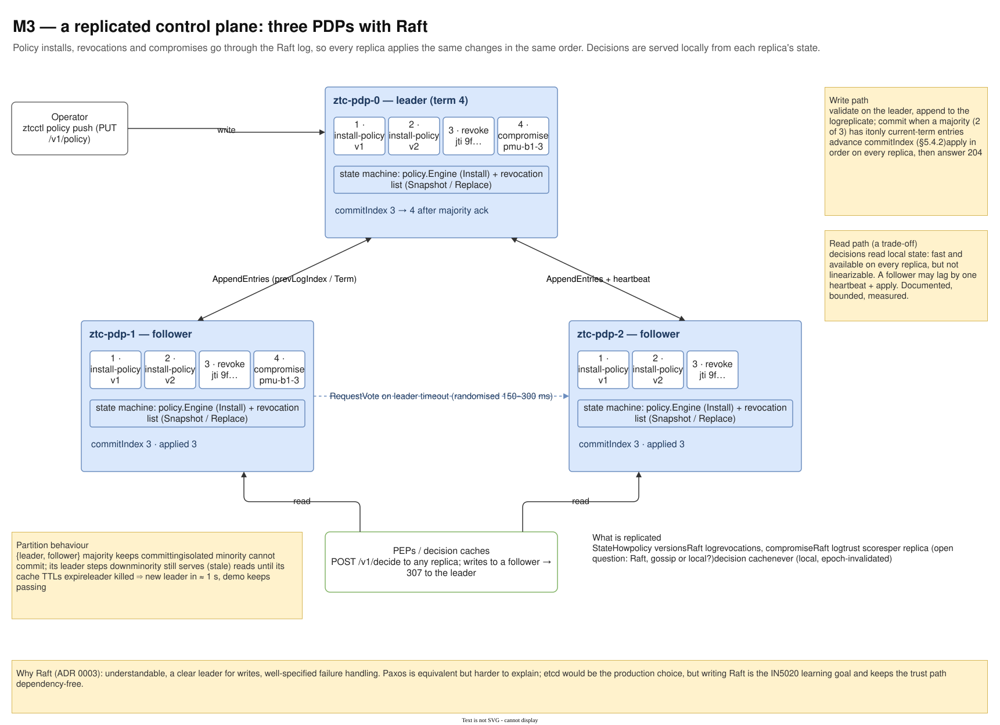
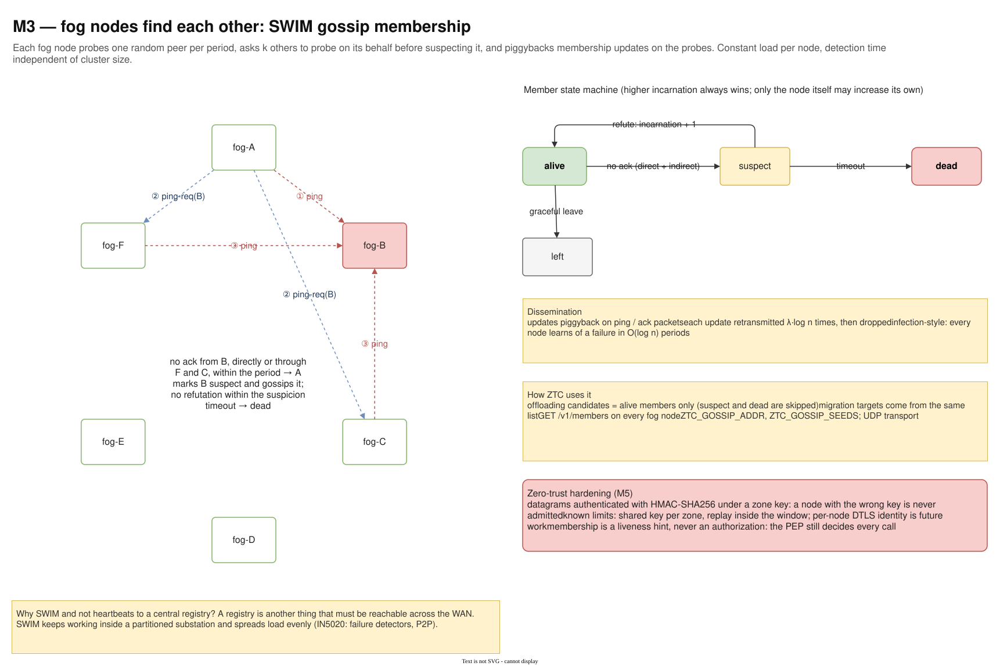
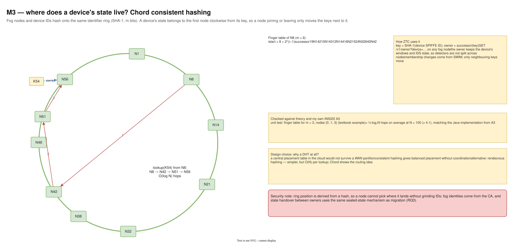
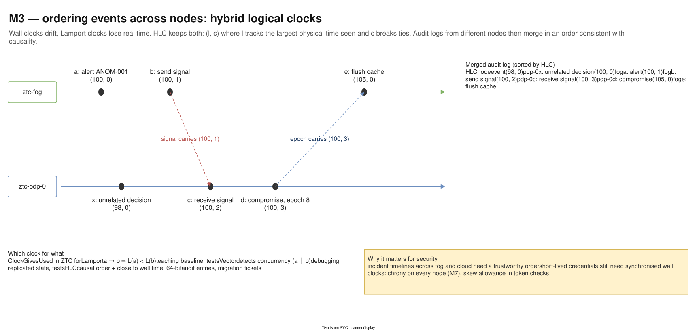

# 08 — M3 Distributed systems

Diagram: [`08-m3-distributed-systems.drawio`](08-m3-distributed-systems.drawio) · 4 pages

## Page 1 — Raft-replicated PDP

Three PDP replicas share a Raft log of policy installs, revocations and compromises. Writes go to the leader (followers redirect with 307), commit on a majority and are applied in order to every replica's state machine. Decisions are read from local state on any replica. A side table says what is and is not replicated, and a note covers partition behaviour.

## Page 2 — SWIM membership

Fog nodes detect failures with SWIM: direct ping, then indirect ping through k helpers, then suspect, then dead unless the node refutes with a higher incarnation number. Updates piggyback on probes. Offloading and migration only consider alive members.

## Page 3 — Chord placement

Device IDs and fog nodes hash onto one ring; a device's state lives on the successor of its key. The finger table gives O(log N) lookups, checked against the textbook example and against an earlier Java implementation.

## Page 4 — Logical clocks

Hybrid logical clocks stamp events on the fog and in the PDP so audit logs from several nodes merge in an order consistent with causality.

## Design decisions

| Decision | Alternatives considered | Why this one |
|---|---|---|
| Raft for PDP replication (ADR) | Paxos; etcd / Consul; primary-backup | Understandable, a clear leader for writes, well-specified failure handling. etcd is the production choice; writing Raft keeps the trust path dependency-free and is the IN5020 learning goal. |
| Replicate commands (install-policy, revoke, compromise), apply after commit | replicate the resulting state | Deterministic state machines stay identical; revocations cannot be lost by a leader crash once committed. |
| Local, non-linearizable reads for decisions | read through the leader | Decisions stay fast and available on every replica; staleness is bounded by one heartbeat plus apply and is documented. |
| Trust scores kept per replica (for now) | trust in the Raft log; gossip | Trust changes many times per second; putting every signal through consensus would overload the log. An open thesis question, written down. |
| StatefulSet-friendly stable IDs and persisted term/vote | in-memory only | A restarted node must never vote twice in one term. |
| SWIM for fog membership | heartbeats to a central registry | A registry is one more thing that must be reachable over the WAN; SWIM works inside a partitioned substation and spreads load evenly. |
| Membership is a liveness hint, never authorization | trust gossip members | Gossip is HMAC-authenticated (M5), but the PEP still decides every call. |
| Chord for state placement | central placement table; rendezvous hashing | No coordinator to lose in a partition; only neighbouring keys move on churn. Rendezvous hashing is simpler but O(N) per lookup. |
| HLC timestamps | wall clock only; Lamport / vector clocks | Causal order and close-to-wall-clock values in 64 bits, practical for audit and incident timelines. |

## Interview talking points

- *Why can a Raft leader only commit entries from its own term?* Otherwise an entry replicated to a majority could still be overwritten after a leader change (Raft §5.4.2); the test suite covers it.
- *What happens when the network splits 2–1?* The majority side keeps committing policy changes; the single node cannot commit, steps down, and serves only stale reads until its caches expire.
- *How do fog nodes find each other without a central server?* SWIM gossip with indirect probing and suspicion, so one slow link does not cause a false death.
