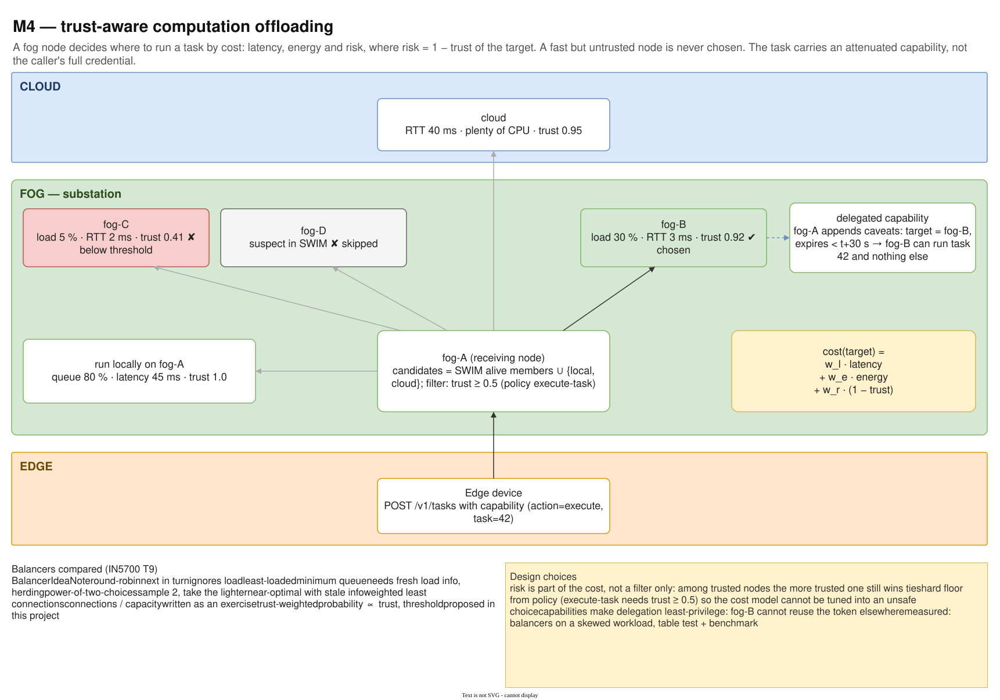
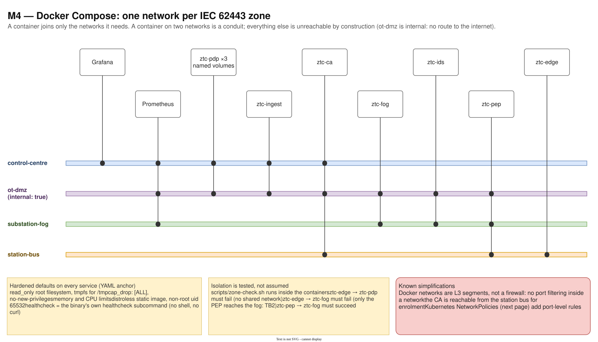
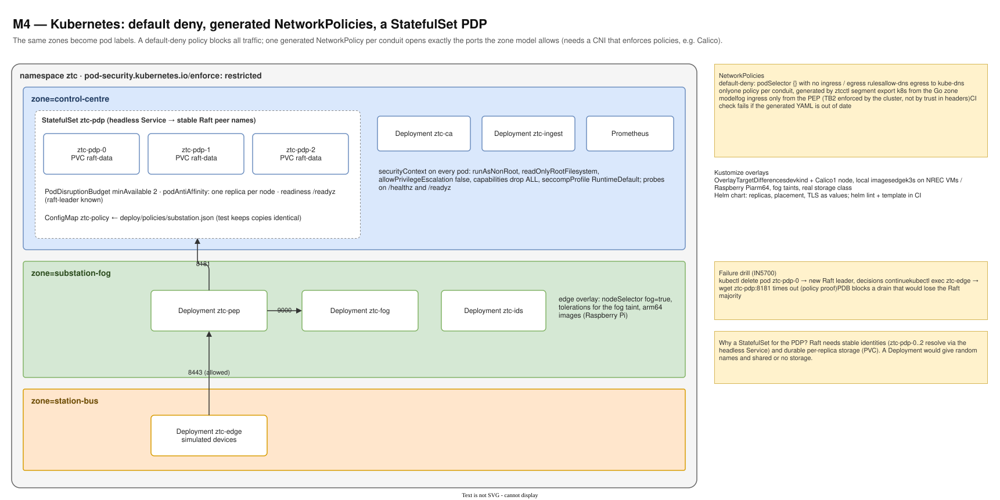

# 09 — M4 Offloading and containers

Diagram: [`09-m4-offloading-containers.drawio`](09-m4-offloading-containers.drawio) · 3 pages

## Page 1 — Trust-aware offloading

A fog node receiving a task picks where to run it by cost = latency + energy + risk, where risk = 1 − trust of the target. Candidates come from SWIM; suspect nodes and nodes below the policy's trust floor are excluded. The chosen node receives an attenuated capability that only lets it run this task, briefly. Five load balancers are compared.

## Page 2 — Docker Compose zones

One Docker network per IEC 62443 zone. Each container joins only the networks it needs (dots on the bars); a container on two networks is a conduit. `ot-dmz` is `internal: true`. Every service runs with hardened defaults, and isolation is tested from inside the containers.

## Page 3 — Kubernetes

A restricted namespace with pods labelled by zone. The PDP is a StatefulSet with PVCs, a PodDisruptionBudget and anti-affinity. A default-deny NetworkPolicy plus one generated policy per conduit opens exactly the allowed ports. Kustomize overlays target kind (laptop) and k3s (fog hardware, arm64).

## Design decisions

| Decision | Alternatives considered | Why this one |
|---|---|---|
| Risk (1 − trust) inside the offloading cost | latency/load only; trust as a filter only | A fast but untrusted node is never chosen, and among trusted nodes the more trusted one wins ties. |
| Hard trust floor from policy (`execute-task` ≥ 0.5) | rely on the cost weights | The cost model cannot be tuned into an unsafe choice. |
| Attenuated capability for the target | forward the caller's token | Least privilege for delegation: the target can run task 42 for 30 s and nothing else. |
| Power-of-two-choices among others, compared on a skewed workload | round-robin only | Near-optimal load spread with stale information (IN5700 T9); measured, not assumed. |
| Distroless, non-root, read-only containers | Alpine/Debian base images | No shell or package manager to abuse, far fewer CVEs; the binary has its own `healthcheck` subcommand. |
| One Docker network per zone | one flat network | Segmentation by construction; matches the zone model exactly. |
| Isolation proven by a script | trust the compose file | `ztc-edge → ztc-pdp` must fail and `ztc-pep → ztc-fog` must succeed; misconfigurations show up in CI. |
| Default-deny NetworkPolicies, generated from the zone model | hand-written YAML | Same model as Cisco ACLs and Compose; no drift. Requires a policy-enforcing CNI (Calico). |
| PDP as StatefulSet | Deployment | Raft needs stable peer names and durable per-replica storage. |
| PDB `minAvailable: 2` | none | A node drain can never take away the Raft majority. |

## Interview talking points

- *How do you offload work in a zero-trust way?* Choose targets by trust as well as load, and hand over a narrowed capability instead of your own credential.
- *How do you prove your Kubernetes network policies work?* Default deny, generated allows, and a test that execs into a pod and shows that a forbidden connection times out. Then `kubectl delete pod ztc-pdp-0` to show Raft failover.
- *What did you harden in the containers?* Distroless static image, non-root UID, read-only root filesystem, all capabilities dropped, no privilege escalation, seccomp default, resource limits.
