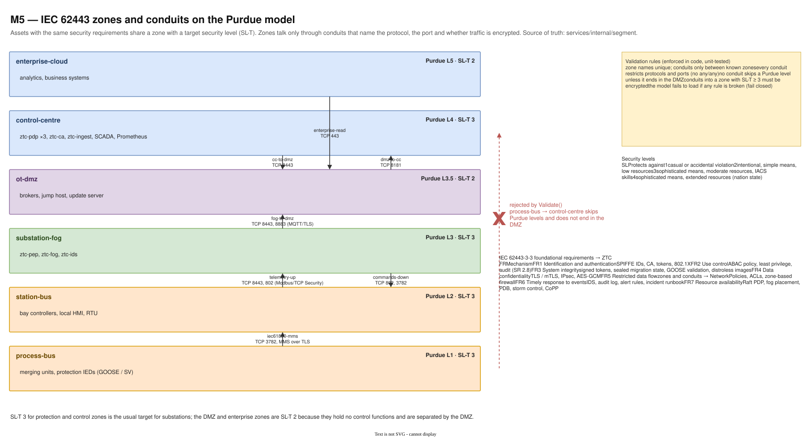
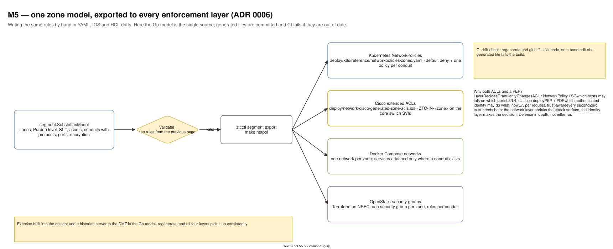

# 10 — M5 IEC 62443 zones and conduits

Diagram: [`10-m5-iec62443-zones.drawio`](10-m5-iec62443-zones.drawio) · 2 pages

## Page 1 — Zones and conduits

Six zones stacked by Purdue level, each with a target security level (SL-T) and its assets. Arrows between zones are conduits with protocol, port and encryption. The red arrow is an example the validator rejects: process bus straight to the control centre skips levels without passing the DMZ. On the right: validation rules, the meaning of SL 1–4, and how ZTC covers the seven foundational requirements of IEC 62443-3-3.

| Zone | Purdue | SL-T | Assets |
|---|---|---|---|
| enterprise-cloud | 5 | 2 | analytics, business systems |
| control-centre | 4 | 3 | ztc-pdp ×3, ztc-ca, ztc-ingest, SCADA |
| ot-dmz | 3.5 | 2 | brokers, jump host, update server |
| substation-fog | 3 | 3 | ztc-pep, ztc-fog, ztc-ids |
| station-bus | 2 | 3 | bay controllers, HMI, RTU |
| process-bus | 1 | 3 | merging units, protection IEDs |

## Page 2 — One model, four enforcement layers

`segment.SubstationModel` in Go is the single source of truth. After validation, `ztcctl segment export` generates Kubernetes NetworkPolicies, Cisco extended ACLs, Docker Compose networks and OpenStack security groups. CI regenerates them and fails on any difference.

## Design decisions

| Decision | Alternatives considered | Why this one |
|---|---|---|
| Zone model in code, validated | a spreadsheet or a diagram only | Rules like "no conduit skips a Purdue level unless it ends in the DMZ" and "conduits into SL-T ≥ 3 are encrypted" become unit tests, and a bad model fails to load. |
| Generate every enforcement layer from one model (ADR 0006) | hand-write YAML, IOS and HCL | Hand-written copies drift; generation plus a CI drift check keeps four layers consistent. |
| Mandatory DMZ between fog and control centre | direct L3 ↔ L4 conduit | Standard IEC 62443 / Purdue practice: no direct path from the enterprise or WAN into control zones. |
| SL-T 3 for control and protection zones, 2 for DMZ and enterprise | SL-T 4 everywhere | SL 3 is the usual target for substations (sophisticated attacker with ICS skills); SL 4 would need controls far beyond the project's scope. |
| Keep the PEP even with ACLs | rely on network segmentation | ACLs decide which hosts may talk on which ports; the PEP decides which authenticated identity may do what now. Different layers, both needed. |

## Interview talking points

- *What is a conduit?* The only allowed communication path between two zones, with explicit protocols, ports and security requirements, like a firewall rule set with a purpose.
- *How do you keep Kubernetes policies and switch ACLs in sync?* Generate both from one validated model and fail CI if a generated file is edited by hand.
- *Why both network segmentation and zero trust?* Defence in depth: segmentation shrinks the attack surface cheaply; identity-based authorization stops the attacker who is already inside a segment.
