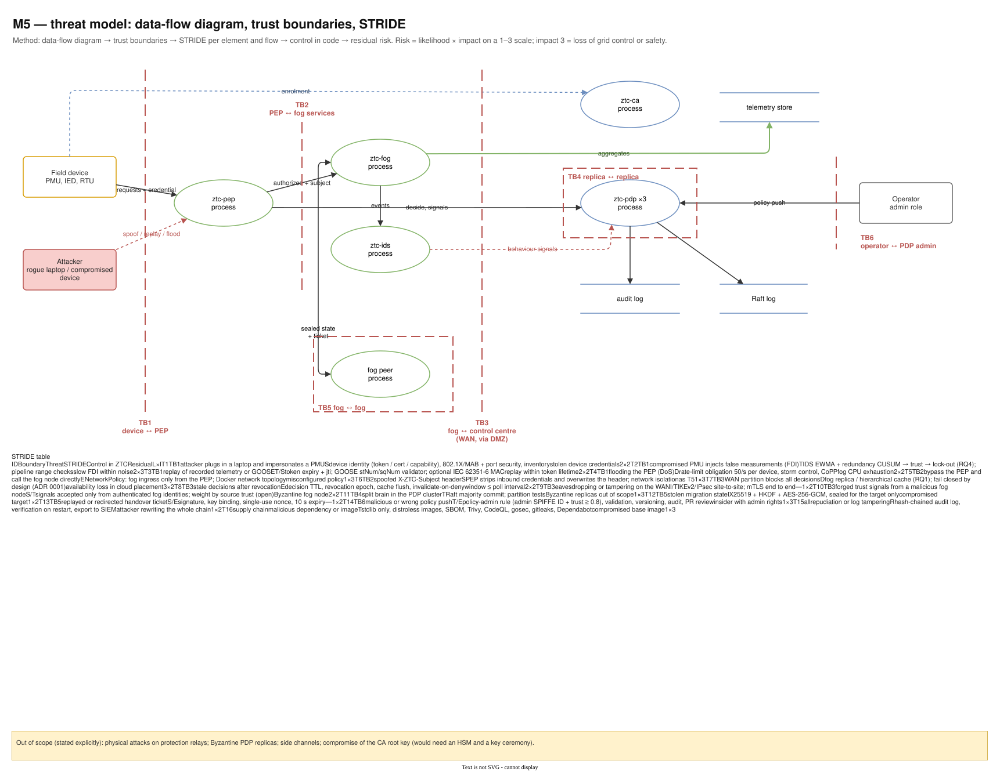
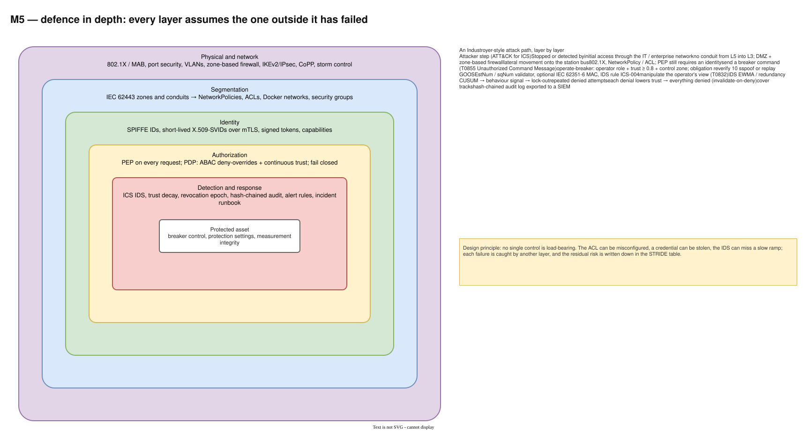

# 11 — M5 Threat model

Diagram: [`11-m5-threat-model.drawio`](11-m5-threat-model.drawio) · 2 pages

## Page 1 — Data-flow diagram, trust boundaries, STRIDE

A data-flow diagram with external entities (field device, attacker, operator), processes (ellipses), data stores (audit log, Raft log, telemetry store) and six trust boundaries:

| # | Boundary | What crosses it |
|---|---|---|
| TB1 | field device ↔ PEP | telemetry, commands, task offloads |
| TB2 | PEP ↔ fog services | authorized requests with `X-ZTC-Subject` |
| TB3 | fog ↔ control centre (WAN, via DMZ) | decisions, trust signals, aggregates, revocations |
| TB4 | PDP replica ↔ replica | Raft log |
| TB5 | fog node ↔ fog node | sealed migration state, handover tickets |
| TB6 | operator ↔ PDP admin API | policy changes |

Below it, the STRIDE table T1–T16: each threat names its boundary, STRIDE category, the control in ZTC, the residual risk and likelihood × impact (impact 3 = loss of grid control or safety). Out-of-scope threats are stated explicitly.

## Page 2 — Defence in depth

Five nested layers around the protected asset (breaker control, protection settings, measurement integrity): physical and network, segmentation, identity, authorization, detection and response. The table follows an Industroyer-style attack step by step and names the layer that stops or detects each step.

## Method and decisions

| Decision | Alternatives considered | Why this one |
|---|---|---|
| STRIDE per trust boundary | asset-only lists; attack trees only | Boundaries are where trust changes, so they are where controls must sit. STRIDE gives a checklist per element and flow. |
| Every threat points to a control in code | generic control lists | Makes the analysis verifiable and keeps it honest: a threat without a control shows up as a gap. |
| Likelihood × impact on a 1–3 scale, impact 3 = grid control / safety | CVSS | CVSS scores IT vulnerabilities; the substation needs impact on physical processes. |
| Residual risk written down | claim full mitigation | Interviewers and supervisors trust analyses that admit what is left (stolen credentials, slow FDI, Byzantine nodes). |
| Explicit out-of-scope list | silent omissions | Physical relay attacks, Byzantine PDP replicas, side channels and CA root compromise are named so nobody assumes they are covered. |
| ATT&CK for ICS walk-through | only STRIDE | Connects abstract threats to how real attacks on the grid unfolded (Ukraine 2015/2016). |

## Highest risks and their answers

- **T7 WAN partition blocks all decisions (3×2)**: fog placement / hierarchical cache (RQ1); fail closed is a deliberate choice.
- **T2 false data injection by a compromised PMU (2×3)**: IDS anomaly + redundancy CUSUM → trust → lock-out (RQ4).
- **T5/T6 bypassing the PEP or spoofing the subject header (1×3)**: network policy lets only the PEP reach the fog; the PEP overwrites the header.
- **T14 malicious policy push (1×3)**: admin SPIFFE ID + high trust, validation, versioning, audit and PR review of policy as code.

## Interview talking points

- *How did you threat-model the system?* Data-flow diagram, draw trust boundaries, STRIDE per boundary, map each threat to a control in code, record residual risk and score likelihood × impact for a grid context.
- *What is the residual risk you worry about most?* A slow false-data-injection ramp that stays inside sensor noise; redundancy between paired sensors is the planned answer.
