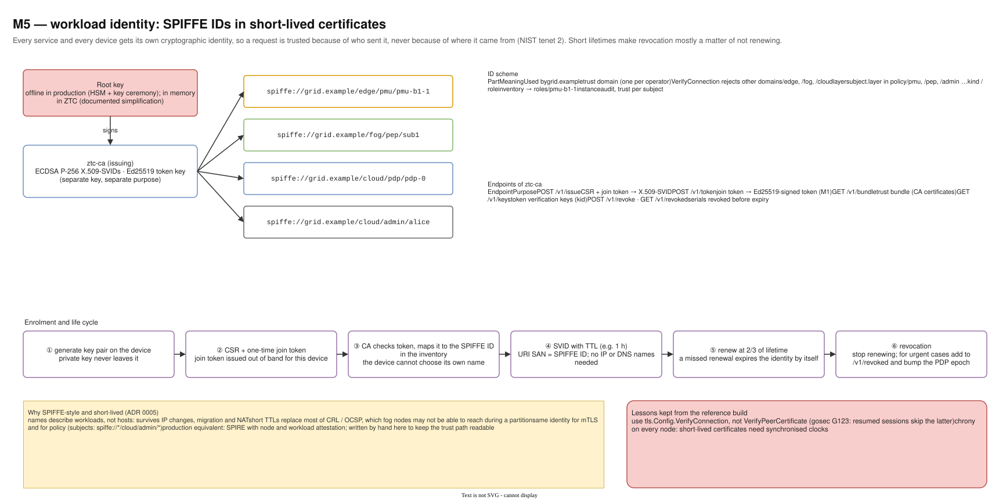
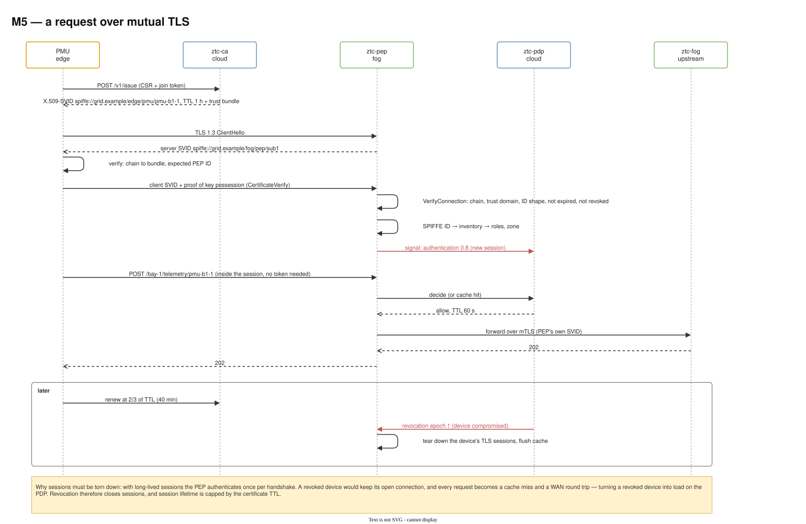

# 12 — M5 Identity and mutual TLS

Diagram: [`12-m5-identity-mtls.drawio`](12-m5-identity-mtls.drawio) · 2 pages

## Page 1 — SPIFFE identity and PKI

A root key signs the issuing CA (`ztc-ca`), which issues short-lived ECDSA P-256 X.509-SVIDs with a SPIFFE ID in the URI SAN, plus a separate Ed25519 key for tokens. The ID scheme `spiffe://grid.example/<layer>/<kind>/<name>` carries the layer and role that policy uses. The enrolment life cycle runs from key generation on the device, through a one-time join token and inventory mapping, to automatic renewal at 2/3 of the lifetime and revocation.

## Page 2 — A request over mutual TLS

Enrolment, a TLS 1.3 handshake in which both sides verify each other's SVID, inventory lookup, an authentication signal of strength 0.8, the decision and the forward to the upstream over the PEP's own mTLS identity. Later: renewal, and on revocation the PEP tears down the device's sessions.

## Design decisions

| Decision | Alternatives considered | Why this one |
|---|---|---|
| SPIFFE-style IDs in certificates (ADR 0005) | IP/DNS-based certificates; usernames | Names describe workloads, not hosts, so they survive IP changes, NAT and migration; the same name is used for mTLS and in policy. |
| Short-lived certificates, renewed at 2/3 | long-lived certificates + CRL/OCSP | Fog nodes may not reach a CRL during a partition; an identity that is not renewed expires by itself. |
| The device generates its key; CSR + one-time join token | CA generates keys and ships them | The private key never leaves the device; the join token proves the enrolment was authorized out of band. |
| The CA maps the join token to the SPIFFE ID from the inventory | device requests its own name | A device cannot choose to become someone else. |
| Separate keys for SVIDs and tokens | one CA key for everything | Different algorithms and purposes; compromise or rotation of one does not affect the other. |
| `VerifyConnection` for peer checks | `VerifyPeerCertificate` | The latter is skipped on resumed TLS sessions (gosec G123). |
| Tear down sessions on revocation; cap session life at the certificate TTL | let sessions run | A revoked device with an open session would keep access and turn every request into a cache miss and WAN load. |
| Root key in memory in ZTC, documented | pretend it is production-grade | Honest scope: production needs an HSM and a key ceremony. SPIRE is the production equivalent for workload identity. |

## Interview talking points

- *What does mTLS give you that a bearer token does not?* Proof of possession: a stolen certificate file is useless without the private key, and the channel is encrypted as well.
- *How do you revoke a certificate in a fog that may be offline?* Mostly by not renewing it (short TTL). For urgent cases, the revoked list and the PDP's revocation epoch, plus closing live sessions.
- *What is a SPIFFE ID?* A URI naming a workload inside a trust domain, carried in an X.509 or JWT credential; it decouples identity from network location.
