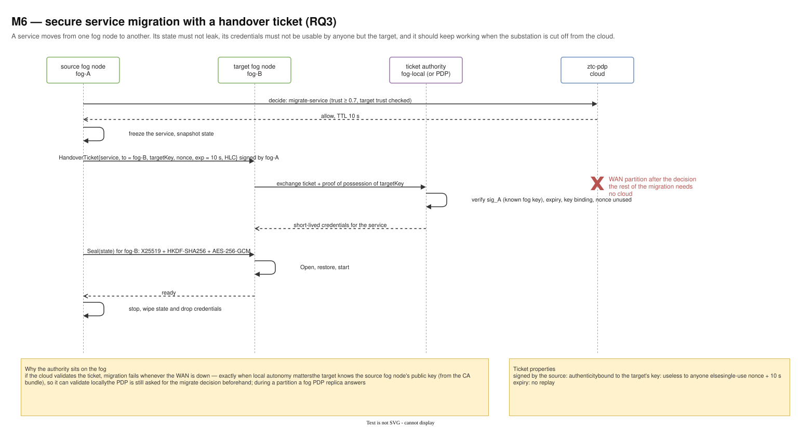
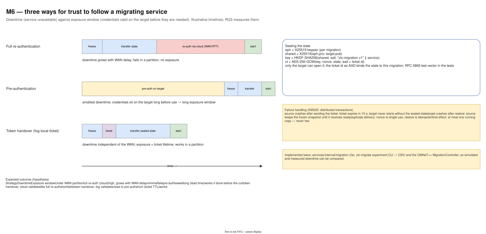

# 13 — M6 Secure service migration (RQ3)

Diagram: [`13-m6-secure-migration.drawio`](13-m6-secure-migration.drawio) · 2 pages

## Page 1 — Handover ticket sequence

The source fog node gets a `migrate-service` decision, freezes the service and sends the target a signed, key-bound, single-use handover ticket with a 10-second expiry. The target exchanges the ticket at a fog-local ticket authority for short-lived service credentials. The source then sends the state sealed for the target's key; the target restores and starts; the source stops and drops its credentials. After the initial decision, nothing in the sequence needs the cloud, so a WAN partition does not stop the migration.

## Page 2 — Three strategies compared

Illustrative timelines for full re-authentication, pre-authentication and token handover, with the expected downtime / exposure / partition behaviour in a table. Also the state-sealing construction (X25519 + HKDF-SHA256 + AES-256-GCM, ticket ID as associated data) and how failures are handled so there is never more than one running copy.

## Design decisions

| Decision | Alternatives considered | Why this one |
|---|---|---|
| Token handover with a ticket | full re-authentication at the cloud; pre-authentication on the target | Full re-auth makes downtime grow with WAN delay and fails in a partition; pre-auth leaves valid credentials on the target long before they are needed. A ticket gives short downtime and a short exposure window. |
| Ticket validated on the fog | ticket validated by the cloud PDP | Cloud validation inherits the WAN dependency. The target knows the source fog node's public key from the CA bundle, so it can validate locally. |
| Ticket bound to the target's key, single-use nonce, 10 s expiry | bearer ticket | A stolen or replayed ticket is useless (threat T13). |
| Seal state with ephemeral X25519 + HKDF + AES-256-GCM | TLS between fog nodes only | Protects the state end to end even if it is stored or relayed; only the target can open it, and the ticket ID as AAD binds it to this migration (threat T12). |
| Source keeps the frozen snapshot until the target says ready | delete on send | A crash on either side never loses the service, and expiry plus idempotent restore mean never two running copies (IN5020: distributed transactions). |
| `migrate-service` needs trust ≥ 0.7, and the target's trust is checked | allow migration like any task | Moving a service changes who can see its data; it deserves a higher bar than running a task. |
| Implemented in Go and in OMNeT++ | simulation only | The simulated downtime can be checked against the real code (`ztc-migrate` experiment CLI). |

## Interview talking points

- *What is the security problem with service migration?* The trust boundary moves with the service: the new host must get exactly the rights the service had, the state must not leak on the way, and the old host must lose access.
- *Why not just pre-authenticate the target?* It minimises downtime but leaves valid credentials sitting on a node long before use. That exposure window is what the handover ticket removes.
- *What if the source crashes right after sending the ticket?* The ticket expires in 10 s and the target never starts without the sealed state, so there is no orphaned or duplicated service.
