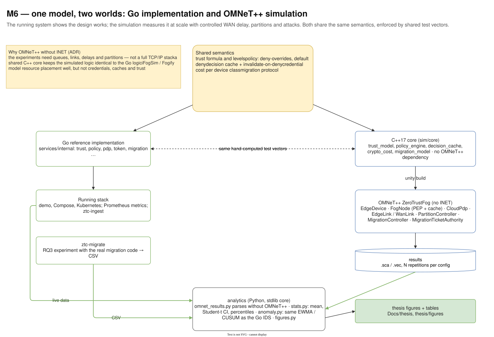
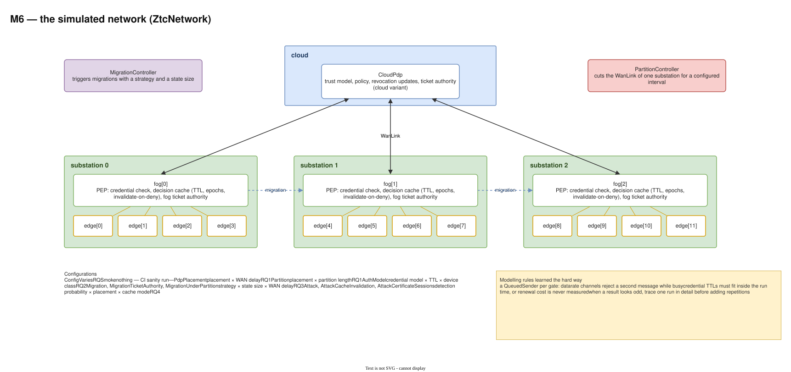
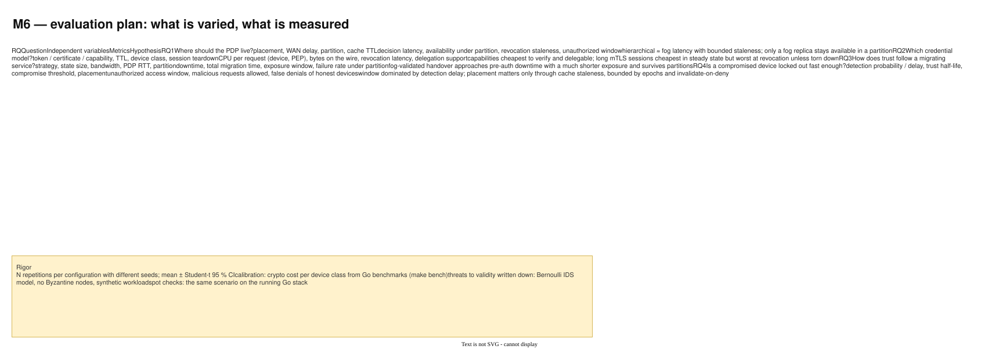

# 14 — M6 Simulation and evaluation

Diagram: [`14-m6-simulation-evaluation.drawio`](14-m6-simulation-evaluation.drawio) · 3 pages

## Page 1 — One model, two worlds

The trust formula, policy semantics, cache invalidation, credential costs and migration protocol exist twice: in the Go services and in a simulator-independent C++17 core (`sim/core`). Both are held together by the same hand-computed test vectors. The C++ core runs inside the OMNeT++ model `ZeroTrustFog`; its results, the live stack and the `ztc-migrate` CSVs all flow into a Python analytics pipeline that produces the thesis figures.

## Page 2 — The simulated network

Three substations, each with a fog node acting as PEP and decision cache and four edge devices, connected over WAN links to a cloud PDP. A PartitionController cuts a substation's WAN link; a MigrationController moves services between fog nodes. The table lists the configurations and which research question each one answers.

## Page 3 — Evaluation matrix

For RQ1–RQ4: the question, the independent variables, the metrics and the hypothesis, plus the rules for statistical rigour.

## Design decisions

| Decision | Alternatives considered | Why this one |
|---|---|---|
| OMNeT++ without INET (ADR) | OMNeT++ + INET; iFogSim; Fogify; ns-3 | The experiments need queues, links, delays and partitions, not a full TCP/IP stack. iFogSim and Fogify model resource placement, not credentials, caches and trust. |
| A shared C++ core with no simulator dependency | write the logic inside OMNeT++ modules | The core is unit-tested on its own (with ASan/UBSan) and uses the same test vectors as Go, so "the simulation and the code agree" is a tested claim. |
| Python analytics with a stdlib core | pandas-only notebooks | Reproducible in CI and readable; parses `.sca/.vec` without OMNeT++ installed. |
| N repetitions, Student-t confidence intervals | single runs | Results come with uncertainty; differences inside the interval are not claimed. |
| Calibrate crypto costs from Go benchmarks | guessed constants | Ties simulated CPU costs to measured ones on real hardware. |
| Threats to validity written down | omit them | Bernoulli IDS model, crash-only failures, synthetic workload: stated so the results are read correctly. |
| Trace one run in detail when a result looks odd | add more repetitions | An odd mean usually hides a mechanism (this is how the invalidate-on-deny issue in RQ4 is found). |

## Interview talking points

- *Why simulate when you have a working system?* The running system shows the design works; the simulation varies WAN delay, partitions, scale and attack timing in controlled, repeatable experiments that real hardware cannot.
- *How do you know the simulation is faithful?* The decision logic is the same model in both, enforced by shared test vectors, and selected scenarios are spot-checked on the real Go stack.
