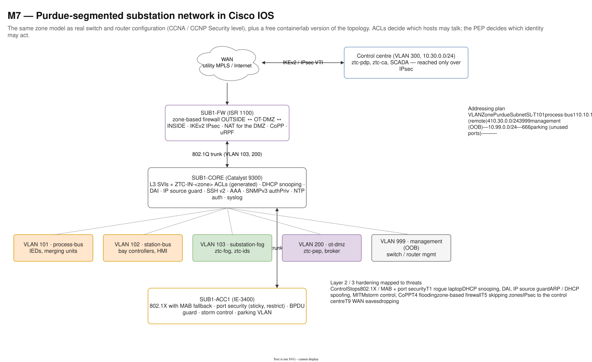
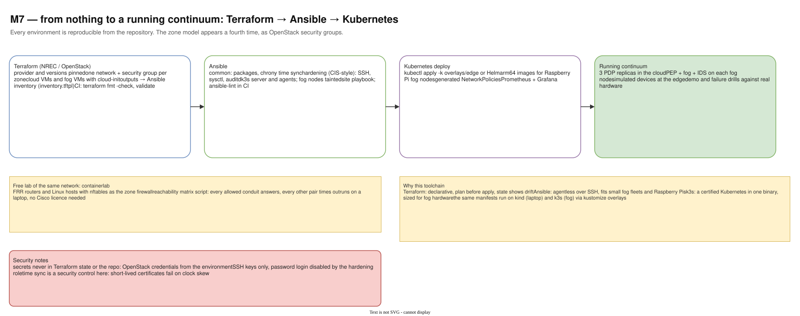

# 15 — M7 Infrastructure and network

Diagram: [`15-m7-infrastructure-network.drawio`](15-m7-infrastructure-network.drawio) · 2 pages

## Page 1 — Purdue-segmented network in Cisco IOS

The substation network as real device configuration: an ISR edge router with a zone-based firewall and IKEv2/IPsec to the control centre, a Catalyst L3 core switch with SVIs and generated per-zone ACLs plus layer-2 security features, and an industrial access switch with 802.1X/MAB and port security. One VLAN per zone, a management VLAN and a parking VLAN for unused ports. The tables give the addressing plan and map each layer-2/3 control to the threats it stops.

## Page 2 — Infrastructure as code

Terraform creates networks, security groups (one per zone) and VMs on NREC (UiO's OpenStack) and generates the Ansible inventory. Ansible applies time sync, CIS-style hardening and k3s with tainted fog nodes. Kustomize or Helm deploys ZTC, including on Raspberry Pi fog nodes. A containerlab version of the network runs on a laptop with a reachability test.

## Design decisions

| Decision | Alternatives considered | Why this one |
|---|---|---|
| Real Cisco IOS configuration | describe the network in prose | Shows the zone model holds at the network layer, and can be typed into Packet Tracer / CML or explained line by line. |
| Zone-based firewall + IPsec to the control centre | plain ACLs over the WAN | Stateful zone policy at the site edge and an encrypted, authenticated site-to-site tunnel (threat T9). |
| 802.1X with MAB fallback, port security, DHCP snooping, DAI | open access ports | Stops a rogue laptop and ARP/DHCP spoofing at the first switch port (threat T1). |
| Generated ACLs on the core | hand-written ACLs | Same validated zone model as Kubernetes and Compose ([10](10-m5-iec62443-zones.md)). |
| Out-of-band management VLAN, parking VLAN | manage in-band | Management stays reachable and separate from production traffic; unused ports lead nowhere. |
| Terraform → Ansible → Kubernetes | click-ops; one tool for everything | Each tool does what it is good at: declarative infrastructure, agentless configuration, orchestration. Every environment is reproducible from the repository. |
| k3s on fog hardware | full Kubernetes; Docker only | A certified Kubernetes in one binary, sized for Raspberry Pi; the same manifests run on kind and k3s. |
| containerlab lab | requires Cisco hardware or licences | Anyone can reproduce the topology and the reachability matrix on a laptop. |
| Time sync treated as a security control | best-effort NTP | Short-lived certificates and token expiry fail on clock skew. |

## Interview talking points

- *Explain your network segmentation.* One VLAN per IEC 62443 zone, routed on the core with generated ACLs, a zone-based firewall and DMZ at the edge, IPsec to the control centre, and 802.1X on access ports. On top of that, the PEP still authorizes every request.
- *How would you deploy this on new hardware?* `terraform apply` for the VMs and security groups, Ansible for hardening and k3s, then `kubectl apply -k` for the edge overlay.
