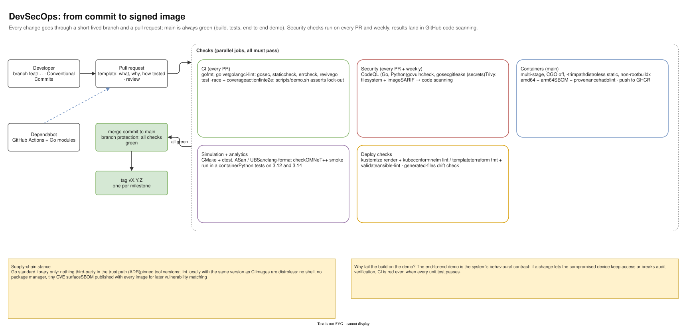

# 16 — DevSecOps pipeline

Diagram: [`16-devsecops-pipeline.drawio`](16-devsecops-pipeline.drawio) · 1 page

## What it shows

A change starts on a short-lived branch with Conventional Commits and goes through a pull request. Five groups of checks run in parallel and must all pass before a merge commit to `main`; each milestone ends with a tag.

| Group | Checks |
|---|---|
| CI (every PR) | gofmt, go vet, golangci-lint (gosec, staticcheck, errcheck, revive), `go test -race` with coverage, actionlint, end-to-end demo that asserts lock-out |
| Security (every PR + weekly) | CodeQL (Go, Python), govulncheck, gosec, gitleaks, Trivy filesystem and image scans, SARIF to code scanning |
| Containers (main) | multi-stage builds, distroless non-root images, amd64 + arm64, SBOM and provenance, hadolint, push to GHCR |
| Simulation + analytics | CMake + ctest with ASan/UBSan, clang-format, OMNeT++ smoke run, Python tests |
| Deploy checks | kustomize render + kubeconform, helm lint/template, terraform fmt/validate, ansible-lint, generated-files drift check |

Dependabot opens PRs for GitHub Actions and Go modules.

## Design decisions

| Decision | Alternatives considered | Why this one |
|---|---|---|
| Short-lived branches, merge commits, `main` always green | long-lived develop branch; squash merges | Small reviewable changes; the history keeps each commit of a feature; `main` is always demo-ready. |
| The end-to-end demo is a CI gate | unit tests only | It is the system's behavioural contract: if a change lets a compromised device keep access or breaks audit verification, CI goes red even when unit tests pass. |
| Race detector on every test run | occasional runs | The concurrent code (trust store, windows, Raft, gossip) is where real bugs hide; the reference build found a concurrent map write this way. |
| Several overlapping security scanners | one tool | Each covers a different class: code patterns (CodeQL, gosec), known CVEs (govulncheck, Trivy), secrets (gitleaks). |
| Standard library only | popular third-party packages | Shrinks the supply chain in the trust path to the Go toolchain itself. |
| Distroless images with SBOM | general-purpose base images | Minimal attack surface and a machine-readable inventory for later vulnerability matching. |
| Pinned tool versions, same locally and in CI | `latest` everywhere | Reproducible results; a linter upgrade is a deliberate change, not a surprise. |

## Interview talking points

- *What does DevSecOps mean in this project?* Security checks are part of every pull request, not a separate phase: static analysis, dependency and image scanning, secret scanning, and a behavioural security test (the lock-out demo).
- *How do you handle supply-chain risk?* Standard library only, distroless images, SBOMs, Dependabot, and pinned versions of every tool.
